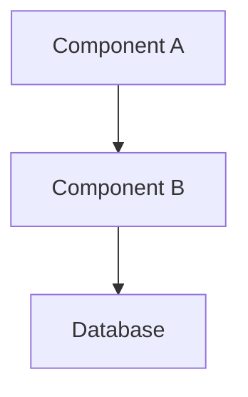
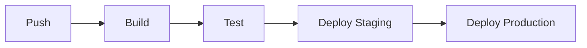

# Wiki — Auto-Generated Codebase Documentation

Generates a comprehensive, structured Wiki for the repository by analyzing code structure and producing browsable markdown and HTML documentation with interactive mindmaps.

**IMPORTANT:** When this skill is invoked, you MUST:
1. Analyze the codebase thoroughly — EVERYTHING including internal details
2. Create actual files in the project directory using Write tool
3. Generate BOTH markdown AND HTML outputs with mindmap
4. NEVER expose `.env` files, secrets, API keys, or sensitive configuration values

## Trigger Conditions

- User invokes `/wiki`
- User asks to "generate documentation", "create wiki", "document the codebase"
- User requests a "codebase overview", "architecture docs", or "project documentation"

## SECURITY — Never Expose These

**ALWAYS REDACT IN WIKI:**
- `.env` files and environment variables
- API keys, tokens, secrets
- Passwords and credentials
- Database connection strings
- Private keys and certificates
- Any file matching `.env*`, `.gitignore`, `secrets.*`, `*.key`
- Environment-specific configurations (PROD_KEY, SECRET, etc.)

**For environment variables, show:**
- Variable name only (e.g., `DATABASE_URL` → `"***REDACTED***"`)
- Type/format (e.g., "string", "URL", "port number")
- Whether it's required/optional
- Do NOT show actual values

## Wiki Structure

### Markdown Output (`{project-root}/.claude/wiki/`)

```
.claude/wiki/
├── README.md                    # Entry point — overview and navigation
├── architecture.md              # High-level architecture and design decisions
├── modules/
│   ├── index.md                 # Module overview
│   ├── [module-name].md        # Per-module documentation
├── api/
│   ├── index.md                 # API overview
│   ├── [api-name].md           # Per-API endpoint documentation
├── patterns.md                  # Common patterns and conventions
├── resources.md                 # External resources, configs, env vars (redacted)
├── workflows.md                 # Build, test, deploy, CI/CD workflows
└── figures/
    └── [diagram-name].md       # Architecture diagrams in Mermaid
```

### HTML Output (`{project-root}/.claude/wiki/html/`)

```
.claude/wiki/html/
├── index.html                   # Main wiki page with navigation
├── mindmap.html                 # Interactive architecture mindmap
├── styles.css                   # Wiki styling
└── assets/
    ├── mindmap-data.json        # Mindmap structure data
    └── diagrams/               # Generated SVG diagrams
```

## Generation Process

### Phase 1: Comprehensive Codebase Analysis

**Use Bash `find`/`ls` and Read tool to explore:**

1. **Project Structure**
   - Root directory layout
   - Source directories (`src/`, `lib/`, `app/`, etc.)
   - Configuration directories
   - Test directories
   - Documentation locations

2. **Source Files — Document EVERYTHING:**
   - All source files (`.ts`, `.js`, `.py`, `.go`, `.rs`, `.java`, `.cpp`, `.c`, etc.)
   - Internal utilities and helpers
   - Private functions and methods
   - Class implementations
   - Function signatures with parameters and return types
   - Type definitions and interfaces
   - Enums and constants

3. **Configuration Files:**
   - `package.json`, `pyproject.toml`, `Cargo.toml`, `go.mod`, etc.
   - Build configurations
   - Linting/formatting configs (ESLint, Prettier, etc.)
   - TypeScript config (`tsconfig.json`)
   - Environment config (NEVER show values from `.env`)
   - Docker configurations
   - CI/CD configurations

4. **API Endpoints — Complete Documentation:**
   For each endpoint, document:
   - **Route/Path** — Full path including parameters
   - **HTTP Method** — GET, POST, PUT, PATCH, DELETE, etc.
   - **Description** — What it does
   - **Authentication** — Required auth type (Bearer, API Key, OAuth, etc.)
   - **Request Headers** — Content-Type, Authorization, custom headers
   - **Request Body** — Schema, required fields, optional fields
   - **Request Parameters** — Path params, query params, headers
   - **Response Body** — Success response schema
   - **Response Codes** — 200, 201, 400, 401, 403, 404, 500, etc.
   - **Error Responses** — Each error code with message and solution
   - **Example Request** — curl command with sample data
   - **Example Response** — JSON response example

5. **Data Models:**
   - Database schemas
   - Entity relationships
   - Data structures
   - TypeScript interfaces/Java classes
   - Serialization formats

6. **Workflows:**
   - Build process and scripts
   - Test execution (unit, integration, e2e)
   - Deployment pipelines
   - CI/CD configuration
   - Development workflows

7. **Dependencies:**
   - External packages/libraries
   - Internal modules
   - Version constraints
   - Peer dependencies

### Phase 2: Create Directory Structure

```bash
mkdir -p .claude/wiki/modules
mkdir -p .claude/wiki/api
mkdir -p .claude/wiki/workflows
mkdir -p .claude/wiki/figures
mkdir -p .claude/wiki/html/assets/diagrams
```

### Phase 3: Generate and Write ALL Files

#### Required Markdown Files:

1. **`.claude/wiki/README.md`** — Entry point
2. **`.claude/wiki/architecture.md`** — System design
3. **`.claude/wiki/modules/index.md`** — Module overview
4. **`.claude/wiki/modules/[module-name].md`** — Per module (EVERY module)
5. **`.claude/wiki/api/index.md`** — API overview
6. **`.claude/wiki/api/[endpoint-name].md`** — Per endpoint (EVERY endpoint)
7. **`.claude/wiki/patterns.md`** — Design patterns
8. **`.claude/wiki/resources.md`** — Configs (REDACTED)
9. **`.claude/wiki/workflows.md`** — CI/CD, builds, deployments

#### Required HTML Files:

1. **`.claude/wiki/html/index.html`** — Interactive wiki
2. **`.claude/wiki/html/mindmap.html`** — Visual architecture mindmap
3. **`.claude/wiki/html/styles.css`** — Styling
4. **`.claude/wiki/html/assets/mindmap-data.json`** — Mindmap data

### Detailed File Specifications

#### README.md (Entry Point)

```markdown
# {Project Name} Wiki

Generated on {date}

## Overview
{Comprehensive description of what this project does and its purpose}

## Quick Navigation
- [Architecture](architecture.md)
- [Modules](modules/)
- [API](api/)
- [Patterns](patterns.md)
- [Resources](resources.md)
- [Workflows](workflows.md)
- [HTML Version](./html/index.html)
- [Mind Map](./html/mindmap.html)

## Project Statistics
- Total modules: N
- Total API endpoints: N
- Total lines of code: N
- Languages used: {list}
- Package manager: {npm/pip/cargo/etc}

## Directory Structure
{ASCII tree of project structure}
```

#### architecture.md

```markdown
# System Architecture

## High-Level Design
{Detailed description of system architecture}

## Component Diagram

```

## Data Flow
{Explain how data moves through the system}

## Key Design Decisions
{Explain architectural choices and rationale}

## Scalability Considerations
{How the system scales}

## Security Architecture
{Never show secrets — describe security model only}
```

#### modules/[module-name].md — EVERY MODULE

```markdown
# {Module Name}

## Overview
{Purpose and responsibility of this module}

## Location
`src/{module-path}/`

## Public API

### Functions

#### `functionName(param1: Type, param2: Type): ReturnType`
- **Description:** {what it does}
- **Parameters:**
  - `param1` — {description} (required)
  - `param2` — {description} (optional, default: {value})
- **Returns:** {description}
- **Throws:** {exceptions that can be thrown}
- **Complexity:** {time and space complexity if relevant}

### Classes/Interfaces

#### `ClassName`
- **Description:** {what it represents}
- **Properties:**
  - `property1` — {description} (type: Type)
  - `property2` — {description} (type: Type, readonly)
- **Methods:**
  - `methodName()` — {description}
  - `static create()` — {description}

## Internal Implementation

### Private Functions
{detail every internal/helper function}

### Constants
- `CONSTANT_NAME` — {description} (value: {type})

## Dependencies
- {dependency1} — {why needed}
- {dependency2} — {why needed}

## Usage Example
\`\`\`{language}
{code example}
\`\`\`
```

#### api/[endpoint-name].md — EVERY ENDPOINT

```markdown
# {HTTP Method} {endpoint-path}

## Overview
{What this endpoint does}

## Endpoint
```
{HTTP Method} /api/v1/resource
```

## Authentication
{Auth type and requirements — e.g., "Bearer token required", "API Key in header"}

## Request

### Headers
| Header | Type | Required | Description |
|--------|------|----------|-------------|
| Content-Type | string | Yes | Must be `application/json` |
| Authorization | string | Yes | Bearer {token} |

### Path Parameters
| Parameter | Type | Description |
|-----------|------|-------------|
| id | string | Resource ID |

### Query Parameters
| Parameter | Type | Required | Default | Description |
|-----------|------|----------|---------|-------------|
| page | number | No | 1 | Page number |
| limit | number | No | 20 | Items per page |

### Request Body
\`\`\`json
{
  "field1": "string (required)",
  "field2": "number (optional)",
  "nested": {
    "key": "string"
  }
}
\`\`\`

## Response

### Success Response (200)
\`\`\`json
{
  "success": true,
  "data": {
    "id": "123",
    "name": "Example"
  },
  "meta": {
    "page": 1,
    "total": 100
  }
}
\`\`\`

### Error Responses

#### 400 Bad Request
\`\`\`json
{
  "success": false,
  "error": {
    "code": "VALIDATION_ERROR",
    "message": "Invalid request parameters",
    "details": [
      { "field": "email", "message": "Invalid email format" }
    ]
  }
}
\`\`\`

#### 401 Unauthorized
\`\`\`json
{
  "success": false,
  "error": {
    "code": "UNAUTHORIZED",
    "message": "Invalid or expired authentication token"
  }
}
\`\`\`

#### 404 Not Found
\`\`\`json
{
  "success": false,
  "error": {
    "code": "NOT_FOUND",
    "message": "Resource not found"
  }
}
\`\`\`

#### 500 Internal Server Error
\`\`\`json
{
  "success": false,
  "error": {
    "code": "INTERNAL_ERROR",
    "message": "An unexpected error occurred"
  }
}
\`\`\`

## Example

### cURL
\`\`\`bash
curl -X GET "https://api.example.com/api/v1/users/123" \
  -H "Authorization: Bearer {token}"
\`\`\`

### JavaScript
\`\`\`javascript
const response = await fetch('/api/v1/users/123', {
  headers: {
    'Authorization': 'Bearer {token}'
  }
});
\`\`\`
```

#### resources.md — REDACTED SENSITIVE VALUES

```markdown
# Configuration Resources

## Environment Variables

| Variable | Type | Required | Description |
|----------|------|----------|-------------|
| DATABASE_URL | string | Yes | Database connection URL |
| API_KEY | string | Yes | API authentication key |
| PORT | number | No | Server port (default: 3000) |
| NODE_ENV | string | No | Environment (development/production) |

> ⚠️ **Note:** Actual values are redacted for security. Contact your administrator for access.

## Configuration Files

### package.json
- **Location:** `package.json`
- **Purpose:** Node.js project configuration
- **Key fields:**
  - `name` — Project identifier
  - `version` — Current version
  - `scripts` — Available npm scripts

### tsconfig.json
- **Location:** `tsconfig.json`
- **Purpose:** TypeScript configuration
- **Key settings:**
  - `target` — Compilation target
  - `strict` — Enable strict type checking
```

#### workflows.md

```markdown
# Workflows

## Build Process

### Development Build
\`\`\`bash
npm run dev
\`\`\`
- Compiles TypeScript
- Starts hot-reload server
- Watches for changes

### Production Build
\`\`\`bash
npm run build
\`\`\`
- Compiles TypeScript to JavaScript
- Optimizes bundle
- Outputs to `dist/` directory

## Testing

### Unit Tests
\`\`\`bash
npm run test:unit
\`\`\`
- Runs Jest unit tests
- Coverage report generated

### Integration Tests
\`\`\`bash
npm run test:integration
\`\`\`
- Tests API endpoints
- Uses test database

## Deployment

### CI/CD Pipeline
{Describe the deployment pipeline with Mermaid diagram}


```

## Mindmap Structure

The mindmap should represent:

```
{Project Name}
├── Architecture
│   ├── Core
│   │   ├── Module A
│   │   │   ├── Sub-module A1
│   │   │   ├── Sub-module A2
│   │   │   └── Helper Functions
│   │   └── Module B
│   │       ├── Main Class
│   │       └── Utilities
│   ├── Data Layer
│   │   ├── Database Schema
│   │   ├── ORM Models
│   │   └── Migrations
│   └── External Services
│       ├── API Clients
│       └── Third-party SDKs
├── API Endpoints
│   ├── /users
│   │   ├── GET /users
│   │   ├── POST /users
│   │   ├── GET /users/:id
│   │   ├── PUT /users/:id
│   │   └── DELETE /users/:id
│   ├── /products
│   └── /orders
├── Workflows
│   ├── Build
│   │   ├── Compile
│   │   ├── Bundle
│   │   └── Minify
│   ├── Test
│   │   ├── Unit
│   │   ├── Integration
│   │   └── E2E
│   ├── Deploy
│   │   ├── Staging
│   │   └── Production
│   └── CI/CD
│       ├── Lint
│       ├── Security Scan
│       └── Deploy
└── Patterns
    ├── Design Patterns
    │   ├── Factory
    │   ├── Singleton
    │   └── Observer
    └── Architectural Patterns
        ├── MVC
        ├── Repository
        └── Service Layer
```

### Mindmap HTML Implementation

Use D3.js for interactive mindmap with:

```html
<!DOCTYPE html>
<html>
<head>
    <script src="https://d3js.org/d3.v7.min.js"></script>
    <style>
        .node { cursor: pointer; }
        .node circle { fill: #fff; stroke: #333; stroke-width: 2px; }
        .node text { font: 12px sans-serif; }
        .link { fill: none; stroke: #ccc; stroke-width: 2px; }
        .mindmap-container { width: 100%; height: 100vh; }
    </style>
</head>
<body>
    <div id="mindmap" class="mindmap-container"></div>
    <script>
        // D3.js mindmap implementation with:
        // - Zoom and pan (d3.zoom)
        // - Click to expand/collapse
        // - Hover tooltips
        // - Search/filter functionality
    </script>
</body>
</html>
```

Or use Markmap for simpler Markdown-based mindmap:

```html
<script src="https://cdn.jsdelivr.net/npm/markmap-autoloader"></script>
```

## Configuration Options

### Output Location
- Markdown: `{project-root}/.claude/wiki/`
- HTML: `{project-root}/.claude/wiki/html/`

### Options
- `--force` — overwrite existing wiki
- `--modules-only` — only generate module docs
- `--api-only` — only generate API docs
- `--html-only` — skip markdown, only generate HTML
- `--mindmap-only` — only generate mindmap

## Quality Standards

1. **Completeness:**
   - Every module must have a page
   - Every function must be documented
   - Every API endpoint must have full documentation

2. **Accuracy:**
   - Code examples must be correct
   - Type signatures must match actual code
   - Cross-references must be valid

3. **Security:**
   - NEVER expose .env or secrets
   - Redact all sensitive values
   - Show only variable names and types

4. **Clarity:**
   - Use consistent formatting
   - Include code examples
   - Add cross-references between related items